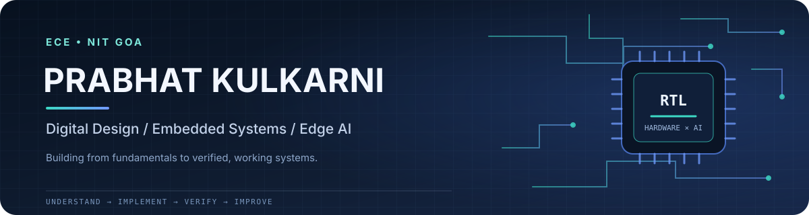

<div align="center">

**ECE Undergraduate · NIT Goa**

[](https://github.com/prabhatkulkarni)
[](https://github.com/prabhatkulkarni/DSD_verilog)
[](https://github.com/prabhatkulkarni/SIH-DFNet3-Edge-Speech-Enhancement)

</div>

## About

I’m an Electronics and Communication Engineering undergraduate interested in the boundary between **digital hardware, embedded systems, signal processing, and machine learning**. My long-term direction is semiconductor and deep-tech engineering.

I like to take an idea through the engineering loop:

`Understand` → `Implement` → `Simulate` → `Measure` → `Debug` → `Document`

## Focus Areas

| Digital Hardware | Embedded Systems | Edge AI & ML |
|:---|:---|:---|
| Verilog RTL | Arduino / C++ | Python / NumPy |
| Combinational & sequential logic | Sensor interfaces | scikit-learn |
| Testbenches & simulation | I²C / serial | PyTorch / ONNX |
| Quartus Prime / ModelSim | PlatformIO | Speech & signal processing |

## Featured Projects

<table>
<tr>
<td width="50%" valign="top">

### 01 / Digital Design
**[DSD Verilog](https://github.com/prabhatkulkarni/DSD_verilog)**

RTL exercises spanning combinational logic, structural/dataflow modelling, adders, counters, and multiplexers. The repository is organized around implementation and simulation.

`Verilog` `RTL` `ModelSim` `Quartus`

</td>
<td width="50%" valign="top">

### 02 / Edge AI
**[SIH — DFNet3 Speech Enhancement](https://github.com/prabhatkulkarni/SIH-DFNet3-Edge-Speech-Enhancement)**

Hindi-focused DeepFilterNet3 fine-tuning, evaluation, ONNX export, and validation against PyTorch. Raspberry Pi 5 deployment and real-time benchmarks remain planned, not claimed as completed.

`Python` `PyTorch` `ONNX` `Audio`

</td>
</tr>
<tr>
<td width="50%" valign="top">

### 03 / Embedded Hardware
**[Arduino Ultrasonic Monitor](https://github.com/prabhatkulkarni/Ultrasonic-Sensor)**

Distance sensing with HC-SR04, DHT11 temperature input, an I²C LCD, LED status indicators, and Python serial plotting.

`Arduino` `C++` `Sensors` `PlatformIO`

</td>
<td width="50%" valign="top">

### 04 / Machine Learning
**[Titanic Survival Prediction](https://github.com/prabhatkulkarni/Titanic-Survival-Prediction)**

An end-to-end classification workflow featuring preprocessing pipelines, feature engineering, eight model comparisons, and evaluation beyond accuracy alone.

`Python` `pandas` `scikit-learn`

</td>
</tr>
</table>

## GitHub at a Glance

<div align="center">


</div>

<sub>These cards are generated by a third-party service and may occasionally be unavailable or delayed.</sub>

## Tools I Use

**Hardware / RTL** · Verilog HDL · Quartus Prime · ModelSim · FPGA workflows

**Programming** · Python · C · C++

**ML / Data** · NumPy · pandas · scikit-learn · PyTorch · ONNX Runtime

**Embedded / Engineering** · Arduino · PlatformIO · Git · Linux · VS Code

## Learning Direction

```text
DIGITAL LOGIC
     ↓
RTL DESIGN + VERIFICATION
     ↓
FPGA / COMPUTER ARCHITECTURE
     ↓
EMBEDDED + HARDWARE-AWARE AI
     ↓
SEMICONDUCTOR / DEEP-TECH SYSTEMS
```

## Engineering Principles

- **Understand the fundamentals.** Know why a circuit or model behaves the way it does.
- **Verify the work.** Use testbenches for RTL and appropriate metrics for ML experiments.
- **Report limits honestly.** Separate measured results from prototypes and future plans.
- **Document for reuse.** Make it possible for another person to understand and run a project.

## Explore

<div align="center">

**[All repositories →](https://github.com/prabhatkulkarni?tab=repositories)**

*Building fundamentals today. Working toward hardware-aware intelligent systems.*

</div>
