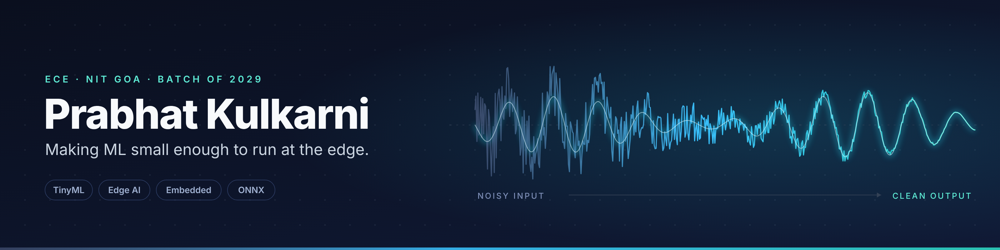

[README.md](https://github.com/user-attachments/files/33395147/README.md)

  

ECE student at NIT Goa, building toward **TinyML, edge AI and embedded systems**. I like taking models out of notebooks and getting them to run on small, constrained hardware.

---

## 🔧 Featured project

### [SIH-DFNet3: Edge Speech Enhancement](https://github.com/prabhatkulkarni/SIH-DFNet3-Edge-Speech-Enhancement)
Fine-tuned **DeepFilterNet3** for Hindi speech enhancement, exported to **ONNX**, targeting **Raspberry Pi 5**. Built for Smart India Hackathon.

| Stage | Status |
| --- | --- |
| Fine-tuning on Hindi speech + diverse noise (DEMAND, ESC-50, MS-SNSD) | ✅ Done |
| Test-set evaluation at ~0 dB input SNR | SDR 2.92 dB · STOI 0.69 |
| ONNX export, validated against PyTorch | ✅ Matches to ~1e-7 error |
| Raspberry Pi 5 latency / RTF benchmark | 🟡 Pending hardware |
| INT8 quantization | ⚪ Planned |

Stack: `Python` · `PyTorch` · `ONNX Runtime` · `Google Colab`

---

## 🛠️ Tech I work with

---

## 🧭 What I'm working on

- Getting DFNet3 running in real time on a Raspberry Pi 5, then optimizing it (quantization, streaming)
- Digital design in Verilog
- Strengthening my deep learning fundamentals, with a focus on models that fit on edge devices

## 🎯 Where I'm headed

I want to build deep tech products at the edge: ML that runs on-device, with low latency and no cloud dependency. I care about the engineering and the business side of getting that into people's hands.

---

## 📫 Connect

Open to collaborating on edge AI, embedded and hackathon projects.
